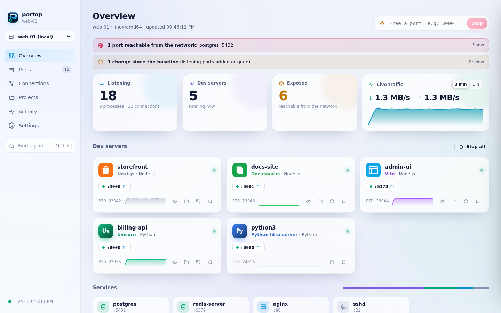
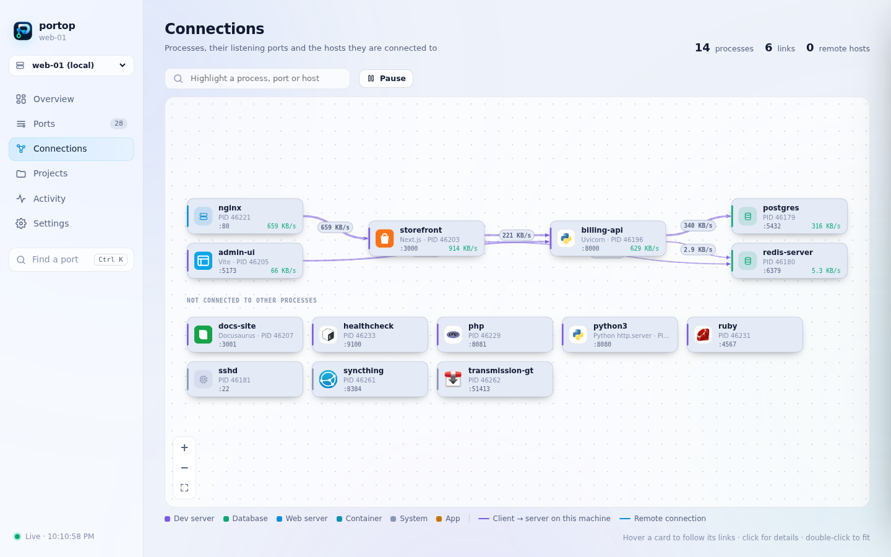

<div align="center">


# portop

[](https://github.com/padovanl/portop/actions/workflows/ci.yml)
[](https://github.com/padovanl/portop/actions/workflows/release.yml)
[](https://github.com/padovanl/portop/releases/latest)
[](https://github.com/padovanl/portop/releases)
[](https://pkg.go.dev/github.com/padovanl/portop)
[](go.mod)
[](LICENSE)

[](https://snapcraft.io/portop)
[](https://formulae.brew.sh/formula/portop)
[](https://padovanl.github.io/portop/docs/installation.html#apt)
[](https://apps.microsoft.com/detail/9MZ319F4LW70)
[](https://github.com/microsoft/winget-pkgs/pull/453604)

**[Website](https://padovanl.github.io/portop/) · [Documentation](https://padovanl.github.io/portop/docs/) · [Releases](https://github.com/padovanl/portop/releases)**

</div>

portop shows every TCP and UDP port on a machine with what is behind it: the
process, the project and framework it serves, its systemd unit or Windows
service, its Docker, Podman or Kubernetes container, who can reach it and what
the firewall does with it. You can inspect or stop the owner safely. It runs on
Linux, macOS and Windows, with three ways to look at the same scan:

| | For | Start it |
|---|---|---|
| ⌨️ **Terminal UI** | servers over SSH, the keyboard, scripts and CI | `portop` |
| 🖥️ **Desktop app** | your dev machine: dev servers, projects, a service map, the tray | `portop-desktop` |
| 🌐 **Web dashboard** | a browser, another machine, Prometheus, Cockpit | `portop --web` |

## ⌨️ Terminal UI

An htop-style table that refreshes live, with the details of any process a key
away. It needs nothing but the `portop` binary, also on a Raspberry Pi.


- Listening and established sockets, sortable by any column, filtered by any
  word; one row for a server's master and workers: `nginx +3`.
- Process details, and SIGTERM or SIGKILL after a confirmation that re-checks
  the process identity.
- New listening ports highlighted live, with an optional desktop notification.
- 13 themes and remappable keys from a live settings screen (`,`); `?` for help.

Run `sudo portop` (an Administrator terminal on Windows) to see other users'
processes and read the firewall.

## 🖥️ Desktop app

The same scan in a window, made for the machine you develop on. The dev servers
you run show as cards with their project, framework, ports and traffic.

<picture>
  <source media="(prefers-color-scheme: dark)" srcset="docs/assets/desktop-overview-dark.png">
  
</picture>

- **Dev servers and projects**: stop, restart in a terminal, open in your
  editor; recently run projects start again with one click.
- **Connections**: a service map of which process talks to which, with the
  traffic between them.
- **Activity**: ports opening and closing, watched ports, and the changes since
  your baseline; notifications you can filter by category.
- **Exposed ports**: a database or dev server reachable from the network
  without a firewall block is flagged.
- **Containers**: start, stop, restart and read the logs.
- **Administrator view**: one password prompt to see and stop every user's
  processes, while the window itself never runs as root.
- **Other machines**: the ports of any machine running `portop --web`, read
  only. Plus a tray menu, a global shortcut, start at login, export to JSON or
  CSV, and light and dark themes.

<picture>
  <source media="(prefers-color-scheme: dark)" srcset="docs/assets/desktop-connections-dark.png">
  
</picture>

It is a separate download for Linux (x86-64; Ubuntu 24.04+, Debian 13+,
Fedora 40+), macOS 12+ and Windows 10/11. See
[Desktop app](https://padovanl.github.io/portop/docs/desktop.html).

## 🌐 Web dashboard and Cockpit

`portop --web` serves the table in a browser, from the same binary: for a
machine without a desktop, or to look at one from another. Sign-in (`--web-auth`),
TLS, Prometheus `/metrics` and a JSON API are built in; the desktop app reads
other machines through that API. On servers managed with Cockpit, the
`portop` page shows the same in Cockpit.


See [web dashboard and metrics](https://padovanl.github.io/portop/docs/web-dashboard.html)
and the [Cockpit add-on](https://padovanl.github.io/portop/docs/cockpit.html).

## 🔎 What portop knows about each port

All three show the same information:

- **The process**: name, PID, user, CPU, command line, working directory and
  the well-known service name (`:22 ssh`).
- **The project and framework** it serves, from `package.json`, `go.mod`,
  `pyproject.toml` and others: `storefront Next.js` instead of `node`; for a
  script, the language of its interpreter.
- **The service**: its systemd unit or Windows service, and its Docker,
  Podman or Kubernetes container, read from cgroups with no daemon of its own.
- **Who can reach it**: every interface, one address or loopback only, and the
  host firewall's verdict: allowed, restricted to some sources, or blocked.
- **Traffic**: bytes per second for every established TCP connection (Linux,
  macOS).

## 📥 Install

| System | Command |
|--------|---------|
| Debian, Ubuntu | [APT repository](https://padovanl.github.io/portop/docs/installation.html#apt) |
| Linux (Snap) | `sudo snap install portop` |
| macOS, Linux | `brew install portop` |
| Windows | `winget install padovanl.portop`, or the [Microsoft Store](https://apps.microsoft.com/detail/9MZ319F4LW70) |
| Linux, macOS | `curl -fsSL https://raw.githubusercontent.com/padovanl/portop/main/install.sh \| sh` |
| From source | `go install github.com/padovanl/portop/cmd/portop@latest` |
| Desktop app | `sudo apt install portop-desktop`, or the [release downloads](https://github.com/padovanl/portop/releases/latest) for Linux, macOS and Windows |

`portop` includes the terminal UI and the web dashboard. The APT repository
serves amd64, arm64 and armhf:

```bash
sudo install -d -m 0755 /etc/apt/keyrings
curl -fsSL https://apt.lucapadovan.dev/lucapadovan.gpg | sudo tee /etc/apt/keyrings/lucapadovan.gpg >/dev/null
echo "deb [signed-by=/etc/apt/keyrings/lucapadovan.gpg] https://apt.lucapadovan.dev stable main" \
  | sudo tee /etc/apt/sources.list.d/lucapadovan.list
sudo apt update && sudo apt install portop
```

Release archives cover Linux on amd64, arm64, ARMv7 and ARMv6, macOS on Intel
and Apple Silicon, and Windows on x64 and ARM64, with `.deb` and `.rpm`
packages for Linux. See [Installation](https://padovanl.github.io/portop/docs/installation.html)
for every option.

## 🧰 Scripts and CI

```bash
portop nginx 443            # the live table, filtered: every word must match
portop --listen             # listening sockets only
portop --json               # one snapshot for scripts

portop --wait 5432          # exit 0 once something listens
portop --free 3000          # stop whatever holds the port, wait until it is free

portop --save-baseline      # record what listens now
portop --diff               # exit 3 if that changed (new, gone, or now exposed)
portop --compose ./stack    # audit a Compose project's published ports

portop --web                # dashboard on http://127.0.0.1:8088
```

The [documentation](https://padovanl.github.io/portop/docs/) covers every
flag, the JSON fields, exit codes and what each platform supports.

## 🆚 Why not just `ss -tlnp`?

|                                  | ss / netstat | lsof | bandwhich | portop |
|----------------------------------|:---:|:---:|:---:|:---:|
| Live, refreshing view            | ❌ | ❌ | ✅ | ✅ |
| Owning process                   | ✅ | ✅ | ✅ | ✅ |
| systemd unit, Windows service    | ❌ | ❌ | ❌ | ✅ |
| Docker, Podman, Kubernetes       | ❌ | ❌ | ❌ | ✅ |
| Exposure and firewall verdict    | ❌ | ❌ | ❌ | ✅ |
| Per-connection traffic           | ✅ `-ti` | ❌ | ✅ | ✅ |
| Stop the owner, safely           | ❌ | ❌ | ❌ | ✅ |
| `--wait` / `--free` for scripts  | ❌ | ❌ | ❌ | ✅ |
| Baseline drift, Compose audit    | ❌ | ❌ | ❌ | ✅ |
| Project and framework            | ❌ | ❌ | ❌ | ✅ |
| Desktop app, web dashboard, Cockpit | ❌ | ❌ | ❌ | ✅ |
| Prometheus metrics               | ❌ | ❌ | ❌ | ✅ |
| Linux, macOS and Windows         | ✅ | ❌ | ✅ | ✅ |

## 📚 Documentation

- [Installation](https://padovanl.github.io/portop/docs/installation.html) and [first run](https://padovanl.github.io/portop/docs/first-run.html)
- [The table](https://padovanl.github.io/portop/docs/the-table.html): columns, colors, keys
- [Command line](https://padovanl.github.io/portop/docs/command-line.html) and [scripting](https://padovanl.github.io/portop/docs/scripting.html)
- [Baseline drift](https://padovanl.github.io/portop/docs/baseline.html) and [Compose audit](https://padovanl.github.io/portop/docs/compose.html)
- [Projects and frameworks](https://padovanl.github.io/portop/docs/projects.html), [containers](https://padovanl.github.io/portop/docs/containers.html), [firewall](https://padovanl.github.io/portop/docs/firewall.html) and [traffic](https://padovanl.github.io/portop/docs/traffic.html)
- [Desktop app](https://padovanl.github.io/portop/docs/desktop.html), [web dashboard and metrics](https://padovanl.github.io/portop/docs/web-dashboard.html), [Cockpit add-on](https://padovanl.github.io/portop/docs/cockpit.html)
- [Configuration](https://padovanl.github.io/portop/docs/configuration.html) and [platform support](https://padovanl.github.io/portop/docs/platforms.html)

The documentation is generated from [`docs-src/`](docs-src) with
`python3 scripts/build-docs.py`; preview the whole site with
`python3 scripts/serve-pages.py`.

## 🤝 Contributing

Pull requests are welcome; see [CONTRIBUTING.md](CONTRIBUTING.md). Open them
against `develop`, and run `gofmt -l . && go vet ./... && go test ./...` before
pushing.

## 📄 License

MIT. See [LICENSE](LICENSE).
