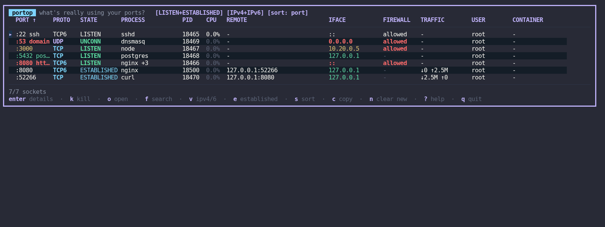
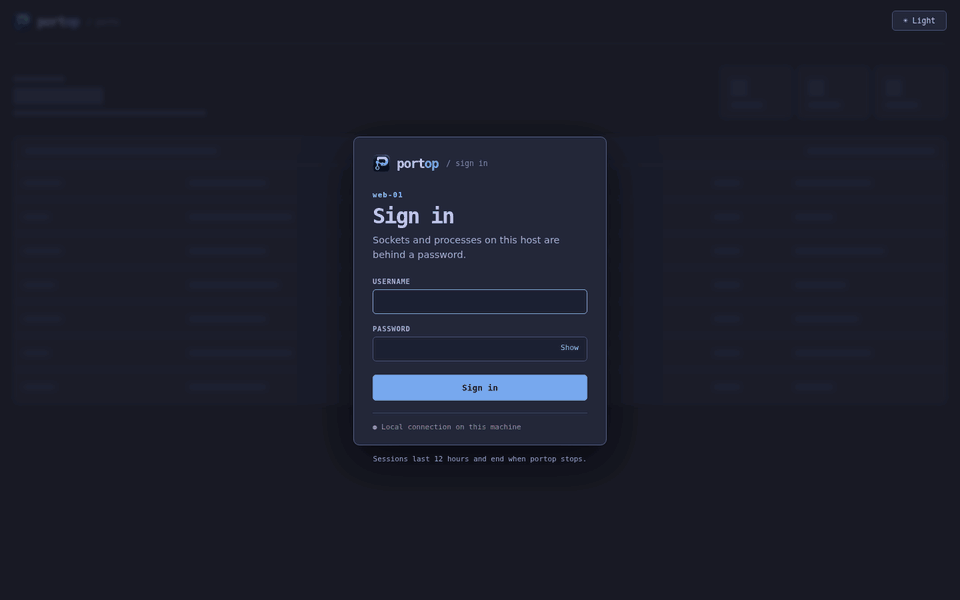

<div align="center">


# portop

[](https://github.com/padovanl/portop/actions/workflows/ci.yml)
[](https://github.com/padovanl/portop/actions/workflows/release.yml)
[](https://github.com/padovanl/portop/releases/latest)
[](https://github.com/padovanl/portop/releases)
[](https://pkg.go.dev/github.com/padovanl/portop)
[](go.mod)
[](LICENSE)

[](https://snapcraft.io/portop)
[](https://formulae.brew.sh/formula/portop)
[](https://padovanl.github.io/portop/docs/installation.html#apt)
[](https://cli.masoko.net/tools/portop/)
[](https://apps.microsoft.com/detail/9MZ319F4LW70)
[](https://github.com/microsoft/winget-pkgs/pull/453604)

**[Website](https://padovanl.github.io/portop/) · [Documentation](https://padovanl.github.io/portop/docs/) · [Releases](https://github.com/padovanl/portop/releases)**

</div>

portop is an htop-style terminal UI for the TCP and UDP sockets on a machine.
For every port it shows the process, its systemd unit or Windows service, its
Docker, Podman or Kubernetes container, who can reach it and what the firewall
does with it, and it lets you inspect or stop the owner from the keyboard. It
runs on Linux, macOS and Windows, in the terminal, in a browser or inside
Cockpit.



## ✨ Features

**See what is using your ports**
- A live table of listening and established sockets with process, PID, CPU,
  user and service names (`:22 ssh`), sortable by any column.
- The systemd unit or Windows service, and the Docker, Podman or Kubernetes
  container behind each socket, read from cgroups with no daemon of its own.
- One row for a server's master and its workers: `nginx +3`.
- Bytes per second for every established TCP connection (Linux, macOS).

**Know who can reach them**
- Listening ports colored by exposure: every interface, one address or
  loopback only.
- The host firewall's verdict for exposed ports: allowed, restricted to some
  sources, or blocked.

**Act on them**
- Process details, and SIGTERM or SIGKILL after a confirmation that re-checks
  the process identity.
- `--wait 5432` blocks until a service listens; `--free 3000` stops whatever
  holds a port and waits until it is released.
- Open a port in the browser, copy a row, filter by any word.

**Catch changes**
- New listening ports are highlighted live, with an optional desktop
  notification.
- `--save-baseline` and `--diff` (exit code 3) report ports that appear,
  disappear or become reachable from the network, from cron or CI.
- `--compose DIR` checks a Docker Compose project's published ports against
  what actually listens.

**Use it anywhere**
- `--json` for scripts, a web dashboard with sign-in, TLS and Prometheus
  `/metrics`, and a Cockpit add-on.
- 13 themes and remappable keys from a live settings screen.

## 📥 Install

| System | Command |
|--------|---------|
| Debian, Ubuntu | [APT repository](https://padovanl.github.io/portop/docs/installation.html#apt) |
| Linux (Snap) | `sudo snap install portop` |
| macOS, Linux | `brew install portop` |
| Windows | `winget install padovanl.portop`, or the [Microsoft Store](https://apps.microsoft.com/detail/9MZ319F4LW70) |
| Linux, macOS | `curl -fsSL https://raw.githubusercontent.com/padovanl/portop/main/install.sh \| sh` |
| From source | `go install github.com/padovanl/portop/cmd/portop@latest` |

The APT repository serves amd64, arm64 and armhf:

```bash
sudo install -d -m 0755 /etc/apt/keyrings
curl -fsSL https://apt.lucapadovan.dev/lucapadovan.gpg | sudo tee /etc/apt/keyrings/lucapadovan.gpg >/dev/null
echo "deb [signed-by=/etc/apt/keyrings/lucapadovan.gpg] https://apt.lucapadovan.dev stable main" \
  | sudo tee /etc/apt/sources.list.d/lucapadovan.list
sudo apt update && sudo apt install portop
```

Release archives cover Linux on amd64, arm64, ARMv7 and ARMv6, macOS on Intel
and Apple Silicon, and Windows on x64 and ARM64, with `.deb` and `.rpm`
packages for Linux. See [Installation](https://padovanl.github.io/portop/docs/installation.html)
for every option.

## ⌨️ Usage

```bash
portop                      # the live table
portop nginx 443            # filtered: every word must match
portop --listen             # listening sockets only
portop --json               # one snapshot for scripts

portop --wait 5432          # exit 0 once something listens
portop --free 3000          # stop whatever holds the port

portop --save-baseline      # record what listens now
portop --diff               # exit 3 if that changed
portop --compose ./stack    # audit a Compose project's ports

portop --web                # dashboard on http://127.0.0.1:8088
```

Run `sudo portop` (an Administrator terminal on Windows) to see other users'
processes and read the firewall. In the table, press `?` for help and `,` for
settings. The [documentation](https://padovanl.github.io/portop/docs/) covers
every flag, the JSON fields, exit codes and what each platform supports.



## 🆚 Why not just `ss -tlnp`?

|                                  | ss / netstat | lsof | bandwhich | portop |
|----------------------------------|:---:|:---:|:---:|:---:|
| Live, refreshing view            | ❌ | ❌ | ✅ | ✅ |
| Owning process                   | ✅ | ✅ | ✅ | ✅ |
| systemd unit, Windows service    | ❌ | ❌ | ❌ | ✅ |
| Docker, Podman, Kubernetes       | ❌ | ❌ | ❌ | ✅ |
| Exposure and firewall verdict    | ❌ | ❌ | ❌ | ✅ |
| Per-connection traffic           | ✅ `-ti` | ❌ | ✅ | ✅ |
| Stop the owner, safely           | ❌ | ❌ | ❌ | ✅ |
| `--wait` / `--free` for scripts  | ❌ | ❌ | ❌ | ✅ |
| Baseline drift, Compose audit    | ❌ | ❌ | ❌ | ✅ |
| Web dashboard, Prometheus        | ❌ | ❌ | ❌ | ✅ |
| Linux, macOS and Windows         | ✅ | ❌ | ✅ | ✅ |

## 📚 Documentation

- [Installation](https://padovanl.github.io/portop/docs/installation.html) and [first run](https://padovanl.github.io/portop/docs/first-run.html)
- [The table](https://padovanl.github.io/portop/docs/the-table.html): columns, colors, keys
- [Command line](https://padovanl.github.io/portop/docs/command-line.html) and [scripting](https://padovanl.github.io/portop/docs/scripting.html)
- [Baseline drift](https://padovanl.github.io/portop/docs/baseline.html) and [Compose audit](https://padovanl.github.io/portop/docs/compose.html)
- [Containers](https://padovanl.github.io/portop/docs/containers.html), [firewall](https://padovanl.github.io/portop/docs/firewall.html) and [traffic](https://padovanl.github.io/portop/docs/traffic.html)
- [Web dashboard and metrics](https://padovanl.github.io/portop/docs/web-dashboard.html), [Cockpit add-on](https://padovanl.github.io/portop/docs/cockpit.html)
- [Configuration](https://padovanl.github.io/portop/docs/configuration.html) and [platform support](https://padovanl.github.io/portop/docs/platforms.html)

The documentation is generated from [`docs-src/`](docs-src) with
`python3 scripts/build-docs.py`; preview the whole site with
`python3 scripts/serve-pages.py`.

## 🤝 Contributing

Pull requests are welcome; see [CONTRIBUTING.md](CONTRIBUTING.md). Open them
against `develop`, and run `gofmt -l . && go vet ./... && go test ./...` before
pushing.

## 📄 License

MIT. See [LICENSE](LICENSE).
